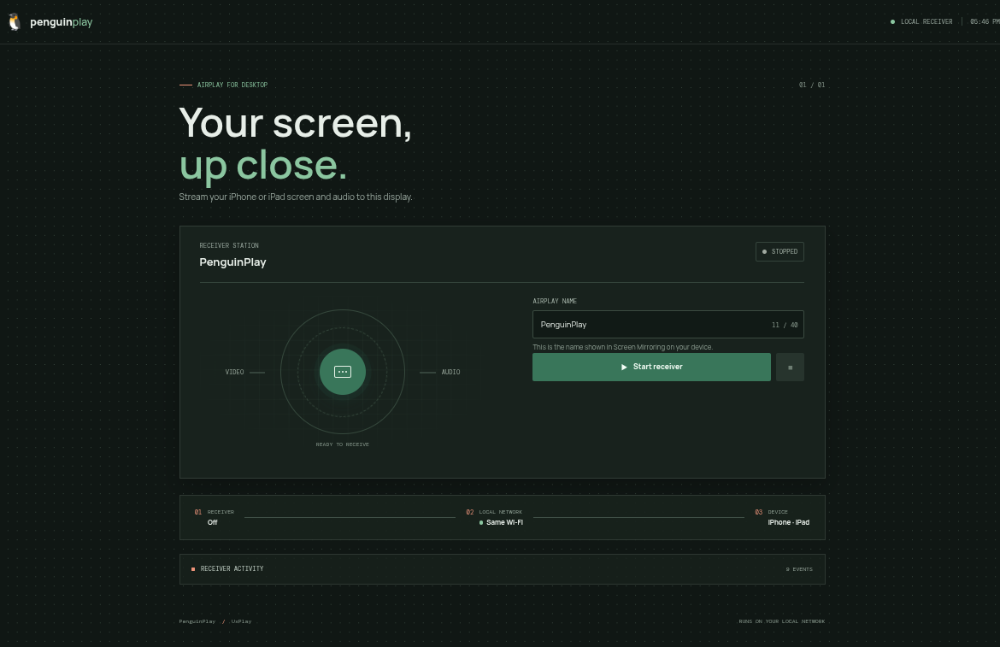

# PenguinPlay

An AirPlay receiver app for Linux and Windows. The desktop app manages [UxPlay](https://github.com/FDH2/UxPlay), which receives mirrored video with audio as well as AirPlay-only audio.



## Downloads

Get the latest [Linux AppImage and Windows installer from GitHub Releases](https://github.com/JonayMr/PenguinPlay/releases/latest). These packages install the PenguinPlay desktop app.

### Linux
- **PenguinPlay-<version>.AppImage** - Self-contained AppImage with no system dependencies required
- **Installation**: Double-click to run, or use `./scripts/install-appimage.sh` for automatic desktop entry registration

### Windows
- **PenguinPlay-Setup-<version>.exe** - Windows installer (NSIS)
- **What's included**: The installer **automatically installs UxPlay and GStreamer** as part of the installation process
- **No separate UxPlay installation required** - Everything you need is bundled in the installer

## Features

- **Zero dependencies** - The Windows installer includes everything needed (UxPlay, GStreamer, MSYS2 if not present)
- **Automatic setup** - No manual MSYS2 or UxPlay installation steps required
- **Portable** - The AppImage for Linux works without system-wide installation
- **Firewall-friendly** - Uses fixed port range (35000-35002) for stable firewall rules


## Run in development

```sh
npm start
```

Open <http://127.0.0.1:4173>. Development uses Electron and electron-builder; the packaged AppImage does not require a system-wide Node.js installation. UxPlay is installed at `~/.local/bin/uxplay` on the development machine.

## Desktop application

Build the package for the current OS:

```sh
npm ci
npm run dist:linux   # Linux AppImage
npm run dist:win     # Windows NSIS installer (run on Windows)
```

On Linux, `./scripts/install-appimage.sh` places the AppImage in `~/.local/opt/penguinplay`, registers a desktop entry in `~/.local/share/applications`, and installs the icon. Caelestia indexes that entry in its Meta+Space launcher. The desktop window starts the local server automatically and stops UxPlay when it closes.

## Run on Windows 10/11

For normal use, download and run `PenguinPlay-Setup-<version>.exe` from the [latest release](https://github.com/JonayMr/PenguinPlay/releases/latest). The installer creates Start Menu and desktop shortcuts; Node.js and the project source are not needed. 

### What the installer includes

The installer **automatically installs UxPlay and GStreamer** as part of the installation process. You do not need to:
- Install MSYS2 separately
- Install UxPlay manually
- Install GStreamer separately

Everything is bundled in the installer. After installation, simply launch PenguinPlay from the Start Menu or desktop shortcut.

### Installation steps

1. **Download** the latest release from [GitHub Releases](https://github.com/JonayMr/PenguinPlay/releases/latest)
2. **Run** `PenguinPlay-Setup-<version>.exe`
3. **Follow** the installation wizard
4. **Launch** PenguinPlay from Start Menu or desktop shortcut

That's it! No additional setup required.

### Build from source

To build the installer from source on Windows:

1. Install [Node.js LTS](https://nodejs.org/)
2. Clone the repository:
   ```sh
   git clone https://github.com/JonayMr/PenguinPlay.git
   cd PenguinPlay
   npm ci
   ```
3. Build the installer:
   ```sh
   npm run dist:win
   ```
4. The installer will be in the `dist/` folder

### First run

After installation, launch PenguinPlay and press **Start receiver**. The control interface will open at <http://127.0.0.1:4173> where you can:
- See the receiver status
- Monitor UxPlay logs
- Control the receiver

### Windows Firewall

The installer will automatically configure Windows Firewall rules for:
- mDNS discovery (UDP 5353)
- AirPlay ports (TCP/UDP 35000-35002)

If Windows Firewall prompts when UxPlay first starts, allow it on **Private networks** only. The receiver uses mDNS on UDP 5353 and TCP/UDP ports 35000–35002.

### Network requirements

- Connect the iPhone/iPad and Windows PC to the **same local Wi-Fi/network**
- Guest Wi-Fi networks with client isolation will not work
- The receiver uses mDNS (UDP 5353) and AirPlay ports (TCP/UDP 35000-35002)

### Compatibility

- Uses the legacy AirPlay mirroring protocol supported by UxPlay
- Screen mirroring carries H.264 video and AAC audio; dedicated audio mode supports ALAC
- DRM-protected video (e.g., Apple TV app content) cannot be decrypted
- Direct HLS streaming depends on app-specific support (e.g., YouTube)
- Use **Screen Mirroring** for general video
- Discovery requires the same local network and mDNS/Avahi

### Performance

At startup, PenguinPlay requests up to 60 FPS and lets GStreamer automatically choose a decoder and video output compatible with your system. Normal audio/video synchronization remains enabled. The 60 FPS value is a request to the iPhone, not a guarantee; actual performance also depends on the content and sending device.

## Connect an iPhone or iPad

1. Connect the iOS device and Linux host to the same Wi-Fi network. Guest networks with client isolation will not work.
2. Start the receiver and wait for the iPhone to connect.
3. On iOS, open Control Center, tap **Screen Mirroring**, and select the configured receiver name.
4. To send audio only, select the receiver from the AirPlay picker in a compatible app.

The firewall must allow mDNS (UDP 5353) and UxPlay's AirPlay ports. PenguinPlay fixes the TCP/UDP range `35000–35002` so firewall rules remain stable between launches; the service is advertised on TCP `35001`. To restrict UFW to your local network, replace the quoted interface and subnet values below with those for your host. Find them with `ip -brief address` and `ip route` (IPv6 routes are shown by `ip -6 route`):

```sh
export LAN_INTERFACE="YOUR_INTERFACE"
export LAN_IPV4_CIDR="YOUR_IPV4_SUBNET/CIDR"
export LAN_IPV6_CIDR="YOUR_IPV6_PREFIX/CIDR"
sudo ufw allow in on "$LAN_INTERFACE" from "$LAN_IPV4_CIDR" to any port 5353 proto udp
sudo ufw allow in on "$LAN_INTERFACE" from "$LAN_IPV4_CIDR" to any port 35000:35002 proto tcp
sudo ufw allow in on "$LAN_INTERFACE" from "$LAN_IPV4_CIDR" to any port 35000:35002 proto udp
sudo ufw allow in on "$LAN_INTERFACE" from "$LAN_IPV6_CIDR" to any port 5353 proto udp
sudo ufw allow in on "$LAN_INTERFACE" from "$LAN_IPV6_CIDR" to any port 35000:35002 proto tcp
sudo ufw allow in on "$LAN_INTERFACE" from "$LAN_IPV6_CIDR" to any port 35000:35002 proto udp
sudo ufw status numbered
```

Set `LAN_INTERFACE`, `LAN_IPV4_CIDR`, and `LAN_IPV6_CIDR` to your interface name and local network prefixes before running those commands. To confirm that the iPhone/iPad is on the same LAN, connect it to the same Wi-Fi/router as this host. Avoid guest Wi-Fi or client isolation. If the receiver appears in Screen Mirroring but iOS reports “Unable to connect,” check the firewall rules first.

## Compatibility

- Uses the legacy AirPlay mirroring protocol supported by UxPlay. It does not implement every AirPlay 2 feature or multi-room audio.
- Screen mirroring carries H.264 video and AAC audio; dedicated audio mode supports ALAC.
- DRM-protected video, such as content from the Apple TV app, cannot be decrypted.
- Direct HLS streaming depends on app-specific support (for example, YouTube). Use **Screen Mirroring** for general video.
- Discovery requires the same local network and mDNS/Avahi; this app does not create a peer-to-peer connection outside that network.

The control interface listens only on `127.0.0.1`. UxPlay/GStreamer process the stream and audio on the host; media does not pass through the browser.

## Performance

At startup, PenguinPlay requests up to 60 FPS and lets GStreamer automatically choose a decoder and video output compatible with the current graphics session. Normal audio/video synchronization remains enabled. The 60 FPS value is a request to the iPhone, not a guarantee; actual performance also depends on the content and sending device.